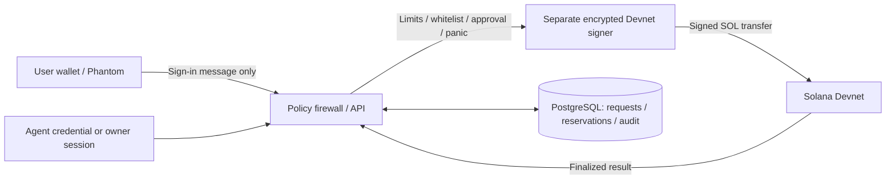

# AgentSafe

    [](backend/package.json)

**A Treasury Firewall for Autonomous AI Agents — zero custody of the owner’s Phantom wallet.** Give agents a separate Solana Devnet test budget, enforce payment policies, and switch between automatic execution and human approval from one dashboard.

Phantom signs a login message and keeps its private key. Payments use a separate Devnet vault whose signer is encrypted in the backend; the operator can sign for that test vault. “Zero custody” applies to the owner’s Phantom wallet, while spending policies are enforced by the backend.

## What you can do

- Create a separate SOL test vault and agents with per-payment and rolling 24-hour limits.
- Restrict recipients, require human approval, freeze an agent, or use the owner-scoped panic button.
- Change automatic/manual execution without releasing an existing approval queue.
- Track approval, reserved budget and settlement separately; inspect finalized transfers in Solana Explorer.
- Recover uncertain requests with durable signed bytes and idempotency keys, without signing replacement transfers after a timeout.
- Explore the landing page, dashboard, simulator and in-app documentation. Simulation never transfers funds.



## Quick start — three steps

Requires Docker with Compose. The isolated demo stack does not reuse the project's existing PostgreSQL container or volume.

1. Clone the demo branch and enter the repository:
   ```bash
   git clone --branch bernardo https://github.com/bernardo-assis/Hakaton.git
   cd Hakaton
   ```
2. Build and start the frontend, API and PostgreSQL (configuration is initialized automatically):
   ```bash
   ./scripts/demo.sh up
   ```
3. Open **http://localhost:8088**, enter the application and sign in with Phantom. Payment execution is disabled by default. Follow the [deployment guide](docs/DEPLOYMENT.md) to explicitly enable Devnet payments; then create and deliberately fund a **test** vault before requesting a payment.

To initialize configuration without starting containers, run `./scripts/demo.sh bootstrap`.

The helper uses `compose.demo.yml`, generates non-secret flags in `.env.demo`, and stores persistent keys and database credentials in the ignored `.demo-secrets/` directory (mode 0700, mounted read-only into containers). Keep the encryption key stable: losing or replacing it makes existing encrypted signers unusable. Never commit real secrets. No public deployment URL is claimed by this repository.

## Implementation and evidence

Frontend: React 19, TypeScript, Vite and Tailwind CSS. Backend: Node.js, Express, Zod, PostgreSQL and `@solana/web3.js`. Runtime migrations live in `backend/src/db/migrations`; the historical SQLite schema is not the server's persistence layer.

The integrated build passed **42 backend tests in eleven suites**, **14 frontend tests**, production builds and browser checks. Financial browser scenarios use a controlled API; authentication scenarios use the real Docker API, an injected wallet provider and real Ed25519 signatures. Checks cover two owners, session restoration, wallet switching, logout and HttpOnly/SameSite=Strict cookies. The adapter also uses real Solana serialization/signatures with injected RPC. These checks do not replace real Phantom extension testing or a funded, finalized Devnet payment. See [QA evidence](docs/PAYMENT_QA.md) and the [manual test guide](docs/PAYMENT_PANEL_MANUAL_TEST.md).

The current payment scope is SOL on Devnet. Pending live validation covers Phantom and funded transfers; an expired transaction with inconclusive history remains `UNKNOWN` and reserved for investigation.

## In-app documentation

Open **Docs** from the landing page to read the product and API guide. Use **Launch App** to enter the workspace; its **Docs** navigation tab keeps the guide available alongside the dashboard. The same guide links back to the application.

## Repository documentation

- [Security architecture and custody boundaries](docs/architecture/SECURITY_ARCHITECTURE.md)
- [REST API](docs/api/REST_API.md)
- [Deployment and local demo](docs/DEPLOYMENT.md)
- [Payment contract](docs/architecture/DEVNET_PAYMENT_PLAN.md)
- [Manual panel validation](docs/PAYMENT_PANEL_MANUAL_TEST.md)
- [Product requirements](docs/prd.md)

The [backend package](backend/package.json) declares `MIT` in its metadata. This repository currently has no `LICENSE` file; the badge records package metadata and does not assert that a complete license grant has been added.
