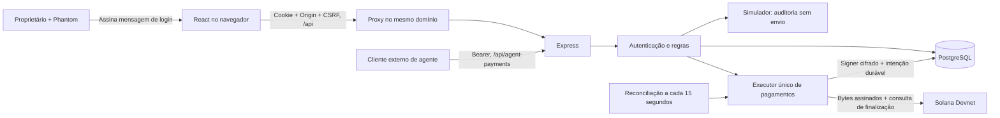

# Arquitetura atual do AgentSafe

Revisão: **12/10/2026**, código de `origin/main` em **`1dd108f5675f982fb5fe70d157f78907ad9f13aa`**. Esta documentação descreve a implementação examinada. O endereço público é <https://agentsafe.kernellabs.uk/>; estar acessível não comprova que a VPS executa esse mesmo commit nem comprova um pagamento finalizado.

## 1. Função do sistema

O AgentSafe controla pedidos de pagamento de agentes na **Solana Devnet**. Um proprietário entra assinando uma mensagem na Phantom, cadastra agentes, configura limites e destinatários, acompanha solicitações e pode exigir aprovação humana ou congelar operações. O backend verifica as regras antes de enviar SOL de teste de um cofre separado.

O simulador aplica regras a pedidos disparados pelos botões. Ele grava avaliações, mas **não envia SOL**. O modo automático permite enviar pedidos autorizados sem uma aprovação individual; não significa que há um modelo de IA decidindo sozinho no backend. Clientes externos podem usar credenciais para chamar a API. O repositório não inclui um LLM, treinamento, classificação de prompt injection, previsões financeiras ou SDK publicado.

## 2. Stack implementada

| Camada | Implementação no snapshot |
| --- | --- |
| Interface | React 19, TypeScript, Vite 8, Tailwind CSS 3, GSAP/Lenis para apresentação |
| Carteira | Provider Phantom via `frontend/src/lib/wallet.ts`; assinatura de mensagem, sem pacote wallet-adapter |
| API | Node.js, Express 4, TypeScript, Zod, express-rate-limit |
| Banco | PostgreSQL com driver `pg`; migrações numeradas e checksums |
| Pagamentos | `@solana/web3.js`, transferências nativas de SOL na Devnet |
| Signer | Chave de cada cofre cifrada com AES-256-GCM; chave de cifragem fornecida ao servidor |
| Publicação de referência | Containers frontend/backend/PostgreSQL; proxy HTTP no frontend; TLS/domínio na infraestrutura da VPS |

As versões acima vêm dos manifests; o lockfile define as resoluções instaladas. SQLite e `schema.sql` são legado e não inicializam a instalação PostgreSQL atual. Não há contrato Solana próprio, multisig on-chain, SPL/USDC, empréstimos, saques, cobrança de planos nem suporte a mainnet no fluxo implementado.

## 3. Conexões entre as partes

O proxy mantém frontend e API na mesma origem, necessário para cookies `SameSite=Strict`. Em produção a API deve reconhecer apenas a origem pública exata. Com um proxy conhecido imediatamente antes da API, usar `TRUST_PROXY_HOPS=1`. As portas do banco e da API não precisam ficar expostas à internet. Ver [DEPLOYMENT.md](../DEPLOYMENT.md) para comandos; a topologia efetiva da VPS requer inspeção do ambiente.

## 4. Endereços e autoridade

| Identificador | Finalidade | Autoridade de pagamento |
| --- | --- | --- |
| `owner_pubkey` | Carteira que assina login e é dona dos recursos | Login não dá acesso aos fundos da Phantom |
| `vault_pubkey` | Endereço do cofre observado ou separado | Apenas cofre com signer separado pode enviar pela API |
| `agent_pubkey` | Identificador público declarado do agente | API autentica pedido por cookie ou token, não pela assinatura dessa chave |
| `recipient_pubkey` | Endereço que receberá SOL | Precisa satisfazer a lista permitida quando ativa |

`/vaults/local` cria um cofre de observação da carteira do proprietário, sem signer. `/vaults/devnet` gera outro endereço, com signer cifrado. O SOL precisa estar no endereço separado para pagar. `Deposit SOL` pede um airdrop ao RPC; não debita a Phantom. A geração rápida de agente cria um identificador público aleatório, sem carteira de agente que assina transferências.

## 5. Autenticação e isolamento

1. `/auth/challenge` gera mensagem com origem, nonce, carteira, emissão, validade e propósito de login.
2. O navegador assina os bytes UTF-8 recebidos e envia assinatura Ed25519 em base64 a `/auth/verify`.
3. A API confere assinatura, origem, cookie temporário e validade de cinco minutos. Consome desafio e cria sessão na mesma transação SQL.
4. O banco guarda hashes dos tokens. Sessões duram oito horas e logout as revoga.
5. Recursos são filtrados por `user_id` **e** `owner_pubkey` da sessão; um UUID público sozinho não autoriza acesso.

Cookies são HttpOnly, `SameSite=Strict`, `Path=/`; em produção usam Secure e prefixo `__Host-`. Mutações de navegador exigem origem permitida e `X-AgentSafe-CSRF: 1`. O caminho exato `/api/agent-payments` aceita clientes sem Origin e sem Cookie com token Bearer. Tokens são específicos do agente, escopo `payments:create`, prazo 60–86400 segundos (padrão 3600), revelados uma vez e revogáveis.

O signer fica cifrado em `vault_signers`, com nonce/tag AES-GCM e vínculo criptográfico ao ID do cofre. `VAULT_SIGNER_ENCRYPTION_KEY` representa **32 bytes em base64 canônico**, não 32 caracteres arbitrários. Preservar essa chave junto ao backup do banco é necessário para recuperar os cofres. Não expor chave, bytes assinados internos ou tokens em relatórios. A custódia é do backend: não equivale a cofre não custodial ou protegido por contrato on-chain.

## 6. Políticas e limites

O executor calcula em lamports inteiros: **1 SOL = 1.000.000.000 lamports**. Valores monetários HTTP são strings. Pagamentos/teto do cofre permitem BIGINT positivo; entradas legadas de agentes/políticas/simulação têm limite menor de inteiro seguro JavaScript. O frontend converte SOL digitado em lamports.

| Regra | Comportamento |
| --- | --- |
| Status | Cofre ou agente congelado impede novas autorizações/envios ainda canceláveis |
| Teto por transação | Principal não supera `single_tx_cap_lamports` do agente |
| Teto do agente | Principal confirmado na janela móvel de 24h + todas as reservas pendentes + novo principal |
| Lista permitida | Obrigatória com `whitelist_enabled` do agente ou `block_unlisted_recipients` do cofre |
| Teto do cofre | Compartilhado por seus agentes; principal + taxas; inclui taxas de pagamentos falhados na rede |
| Saldo | Saldo observado finalizado menos reservas precisa cobrir principal e taxa |
| Saldo mínimo | Quando ativo, saldo restante após envio mantém o limiar configurado |
| Aprovação | MANUAL exige aprovação; AUTOMATIC também exige quando política ativa e principal **maior** que limiar |

Novo cofre separado começa **AUTOMATIC**, teto **1 SOL**, políticas opcionais desligadas. Cofres externos observados ficam MANUAL e sem signer. Novo agente usa teto individual igual ao diário e whitelist desligada quando esses campos são omitidos. Dois pagamentos de 0,5 SOL excedem teto de 1 SOL ao incluir taxas. Para demo controlada, selecionar MANUAL antes de solicitar o primeiro pagamento e escolher limites compatíveis.

A simulação usa dia civil UTC e soma só simulações aprovadas. É separada da janela móvel do executor; sua aprovação não garante saldo nem aprovação do pagamento. O gráfico do dashboard main agrega simulações e pedidos; suas contagens não representam pagamentos finalizados.

## 7. Ciclo de pagamento

1. Criar chave de idempotência estável por intenção. O painel a salva com escopo proprietário/cofre antes do POST; retries mantêm essa chave.
2. Validar corpo e proprietário ou token. Resolver cofre e obter lock PostgreSQL por cofre, compartilhado com alterações administrativas.
3. Replay idêntico retorna registro anterior, incluindo bloqueado; payload diferente com mesma chave retorna 409.
4. Conferir Devnet pelo genesis hash, preparar bytes assinados, estimar taxa e observar saldo. RPCs ficam fora de transações SQL longas.
5. Revalidar regras em transação curta. Bloqueios dessa etapa são registrados `BLOCKED/NOT_SUBMITTED`; falhas anteriores, como RPC indisponível, podem não criar registro.
6. MANUAL grava `APPROVED/PENDING/NOT_SUBMITTED` e aguarda. **A fila não reserva saldo**; aprovação revalida tudo porque outros pedidos podem consumir orçamento.
7. Antes de transmitir, persistir reserva, taxa, assinatura, bytes, blockhash, validade e início do despacho. Manter lock durante COMMIT/broadcast.
8. Marcar `CONFIRMED` só depois de status finalizado e comparação da transação observada com bytes esperados. HTTP 200, assinatura e `APPROVED` isolados não provam liquidação.
9. Resultado incerto após possível envio gera `UNKNOWN`, conserva reserva e é consultado a cada 15 segundos. Pode retransmitir **os mesmos bytes e assinatura** ainda válidos, respeitando políticas atuais e credencial.
10. Nunca reassinar substituto por timeout. Expiração do blockhash sem prova conclusiva não libera reserva apenas por relógio.

MANUAL→AUTOMATIC não libera a fila antiga. AUTOMATIC→MANUAL afeta pedidos ainda não despachados. Alterar modo/teto exige `expected_mode_version`. Freeze/panic não desfaz transferência enviada à Solana.

## 8. Código e persistência

| Área | Referências em `backend/src` ou `frontend/src` |
| --- | --- |
| HTTP e proteção | `app.ts`, `middleware/walletAuth.ts`, `config/unifiedConfig.ts` |
| Login | `AuthController`, `authService`, `AuthRepository` |
| Gestão/simulação | `UiController`, `uiService`, `UiRepository`, `validators/ui.schema.ts` |
| Agentes | `AgentController`, `agentService`, `AgentRepository`, `validators/agent.schema.ts` |
| Executor | `PaymentController`, `paymentService`, `PaymentRepository`, `paymentNetwork.ts` |
| Recuperação | `backend/src/server.ts` |
| Migrações | `backend/src/db/migrations/0001` a `0004`, `backend/scripts/migrate.cjs` |
| Telas | `frontend/src/pages/{Dashboard,AgentFleet,VaultBudgets,Simulator,Docs}.tsx` |
| Painel financeiro | `frontend/src/components/DevnetPayments.tsx`, `frontend/src/lib/payments.ts` |

Tabelas: `users`, `wallet_identities`, `wallet_challenges`, `auth_sessions`, `vaults`, `vault_signers`, `agents`, `whitelist_recipients`, `agent_credentials`, `transactions`, `audit_events`. Produção aplica migrações antes de iniciar, registra checksums e recusa SQL divergente. Alterar migração aplicada não substitui criar nova migração. [DATABASE.md](DATABASE.md) contém histórico; interpretar junto às migrações atuais e não copiar DDL SQLite para PostgreSQL.

`POST /api/transactions` permanece 501 para impedir signer global legado. O método antigo existe no código, mas a rota não o chama. Transferências autorizadas passam por `/api/payments` ou `/api/agent-payments`.

## 9. Operação e evidências

Limites por IP/minuto: 240 leituras GET/HEAD, 100 mutações, 60 mutações de autenticação, 30 mutações financeiras. Challenge/verify têm adicional de 100 chamadas/15 minutos. Limites se somam e usam memória do processo; replicar API exigiria coordenação. PostgreSQL possui timeout de statement de três segundos; RPCs do executor possuem timeout de oito segundos, exigindo testar contenção.

`/healthz` comprova processo HTTP e `/readyz` PostgreSQL. Não comprovam RPC, signer, saldo, liquidação ou equivalência VPS/main. API define cabeçalhos de proteção, no-store e erros sem stack; proxy do HTML precisa de configuração própria. Sentry está comentado; logs básicos não formam observabilidade completa.

## 10. Limitação descoberta em main

Main permite mudar `agents.vault_id` pela edição ou seleção de agente no painel financeiro. Pagamentos persistem só `agent_id` e derivam cofre atual por join. **Mover agente com histórico pode deslocar gastos, reservas, fila e reconciliação para outro cofre, embora o envio original pertença ao anterior.** Falta também revalidar vínculo depois de resolver cofre antes do lock.

Até corrigir e testar, manter agente no cofre original quando existem pedidos e criar outro agente para outro cofre. A correção deve impedir movimentos incompatíveis ou persistir origem imutável por pagamento, usando-a em orçamento/fila/reconciliação e revalidando vínculo sob lock. Ver [revisão com evidências](../handoffs/2026-10-12-main-architecture-review.md).

## 11. Aceite do MVP

| Evidência necessária | Validação |
| --- | --- |
| Login e isolamento | Phantom real, troca de carteira, outra identidade sem acesso anterior |
| Liquidação | Cofre financiado, pedido pequeno, assinatura/destinatário/valor finalizados no Explorer |
| Políticas | Teto, lista, freeze, aprovação/rejeição; bloqueio não envia |
| Recuperação | Resultado incerto/reinício, assinatura única e reserva preservada |
| Movimento de agente | Histórico e signer não migram indevidamente; corrida movimento/pagamento coberta |
| VPS | Commit/imagem identificável, backup restaurável com chave do signer, TLS/proxy/logs |
| Interface | Fluxo desktop/mobile, teclado, nomes acessíveis, estados de erro |

RPC/provider simulados verificam contratos, mas não substituem Phantom e Solana reais na VPS. Contratos em [REST_API.md](../api/REST_API.md); roteiro do usuário em [PUBLISHED_APP_MANUAL_TEST_PT.md](../PUBLISHED_APP_MANUAL_TEST_PT.md).
