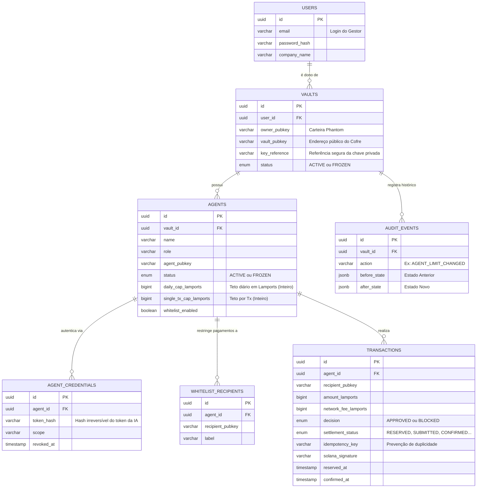

# Modelagem do Banco de Dados (PostgreSQL)

**Projeto:** AgentSafe
**Data:** 08 de Outubro de 2026
**Motor:** PostgreSQL Puro
**Autor:** @architect (Jotaf) & Bernardo

---

## 1. Visão Geral da Modelagem (A Fusão)

Esta modelagem representa a fusão da decisão de infraestrutura do Jotaf (**PostgreSQL + Dupla Autenticação com Email/Senha**) com as diretrizes de segurança transacional e precisão propostas pelo Bernardo (**Inteiros em Lamports, Máquina de Liquidação e Auditoria Estrita**).

## 2. Diagrama Entidade-Relacionamento (ERD)



---

## 3. Schema SQL Oficial (PostgreSQL)

```sql
-- Extensão para UUIDs
CREATE EXTENSION IF NOT EXISTS "uuid-ossp";

-- Tipos (Enums) de Segurança e Liquidação
CREATE TYPE vault_status AS ENUM ('ACTIVE', 'FROZEN');
CREATE TYPE agent_status AS ENUM ('ACTIVE', 'FROZEN');
CREATE TYPE tx_decision AS ENUM ('APPROVED', 'BLOCKED');
CREATE TYPE tx_settlement AS ENUM ('NOT_SUBMITTED', 'RESERVED', 'SUBMITTED', 'CONFIRMED', 'FAILED', 'UNKNOWN');

-- 1. Usuários (Autenticação Web2 Tradicional resolvida)
CREATE TABLE users (
    id UUID PRIMARY KEY DEFAULT uuid_generate_v4(),
    email VARCHAR(255) UNIQUE NOT NULL,
    password_hash VARCHAR(255) NOT NULL,
    company_name VARCHAR(100),
    created_at TIMESTAMP WITH TIME ZONE DEFAULT CURRENT_TIMESTAMP
);

-- 2. Cofres Mestres
CREATE TABLE vaults (
    id UUID PRIMARY KEY DEFAULT uuid_generate_v4(),
    user_id UUID NOT NULL REFERENCES users(id) ON DELETE RESTRICT,
    owner_pubkey VARCHAR(44) NOT NULL,
    vault_pubkey VARCHAR(44) NOT NULL,
    key_reference VARCHAR(255) NOT NULL, -- Nunca a chave em claro
    status vault_status DEFAULT 'ACTIVE',
    created_at TIMESTAMP WITH TIME ZONE DEFAULT CURRENT_TIMESTAMP
);

-- 3. Fichas dos Agentes (Inteiros BIGINT para Lamports)
CREATE TABLE agents (
    id UUID PRIMARY KEY DEFAULT uuid_generate_v4(),
    vault_id UUID NOT NULL REFERENCES vaults(id) ON DELETE CASCADE,
    name VARCHAR(100) NOT NULL,
    role VARCHAR(200) NOT NULL,
    agent_pubkey VARCHAR(44) NOT NULL,
    status agent_status DEFAULT 'ACTIVE',
    daily_cap_lamports BIGINT NOT NULL,   -- BigInt no Postgres suporta até 19 dígitos
    single_tx_cap_lamports BIGINT NOT NULL,
    whitelist_enabled BOOLEAN DEFAULT FALSE,
    created_at TIMESTAMP WITH TIME ZONE DEFAULT CURRENT_TIMESTAMP
);

-- 4. Credenciais dos Agentes (Segurança contra vazamento de tokens)
CREATE TABLE agent_credentials (
    id UUID PRIMARY KEY DEFAULT uuid_generate_v4(),
    agent_id UUID NOT NULL REFERENCES agents(id) ON DELETE CASCADE,
    token_hash VARCHAR(255) NOT NULL UNIQUE,
    scope VARCHAR(100),
    expires_at TIMESTAMP WITH TIME ZONE,
    revoked_at TIMESTAMP WITH TIME ZONE,
    created_at TIMESTAMP WITH TIME ZONE DEFAULT CURRENT_TIMESTAMP
);

-- 5. Whitelist (Lista Vip)
CREATE TABLE whitelist_recipients (
    id UUID PRIMARY KEY DEFAULT uuid_generate_v4(),
    agent_id UUID NOT NULL REFERENCES agents(id) ON DELETE CASCADE,
    recipient_pubkey VARCHAR(44) NOT NULL,
    label VARCHAR(100) NOT NULL,
    created_at TIMESTAMP WITH TIME ZONE DEFAULT CURRENT_TIMESTAMP,
    UNIQUE(agent_id, recipient_pubkey) -- Regra do Bernardo: único por agente
);

-- 6. Transações com Ciclo de Vida Completo (Reserva e Liquidação)
CREATE TABLE transactions (
    id UUID PRIMARY KEY DEFAULT uuid_generate_v4(),
    agent_id UUID NOT NULL REFERENCES agents(id) ON DELETE RESTRICT,
    idempotency_key VARCHAR(100) NOT NULL,
    request_hash VARCHAR(255) NOT NULL,
    recipient_pubkey VARCHAR(44) NOT NULL,
    amount_lamports BIGINT NOT NULL,
    network_fee_lamports BIGINT DEFAULT 0,
    
    decision tx_decision NOT NULL,
    settlement_status tx_settlement NOT NULL,
    
    error_code VARCHAR(100),
    purpose TEXT,
    
    solana_signature VARCHAR(88) UNIQUE,
    signed_tx_reference TEXT,
    
    reserved_at TIMESTAMP WITH TIME ZONE,
    submitted_at TIMESTAMP WITH TIME ZONE,
    confirmed_at TIMESTAMP WITH TIME ZONE,
    resolved_at TIMESTAMP WITH TIME ZONE,
    created_at TIMESTAMP WITH TIME ZONE DEFAULT CURRENT_TIMESTAMP,
    
    UNIQUE(agent_id, idempotency_key)
);

-- 7. Log de Auditoria Imutável (Ações de Gestão)
CREATE TABLE audit_events (
    id UUID PRIMARY KEY DEFAULT uuid_generate_v4(),
    vault_id UUID NOT NULL REFERENCES vaults(id) ON DELETE CASCADE,
    actor_id VARCHAR(100) NOT NULL, -- Pode ser UUID do usuário ou da chave
    action VARCHAR(100) NOT NULL,   -- Ex: LIMIT_UPDATED, FROZEN_AGENT
    target_id VARCHAR(100) NOT NULL,
    reason TEXT,
    before_state JSONB, -- JSONB é excelente no Postgres para auditoria
    after_state JSONB,
    created_at TIMESTAMP WITH TIME ZONE DEFAULT CURRENT_TIMESTAMP
);

-- Índices Críticos de Performance
CREATE INDEX idx_transactions_agent_status ON transactions(agent_id, settlement_status);
CREATE INDEX idx_transactions_reserved_at ON transactions(reserved_at);
CREATE INDEX idx_audit_vault ON audit_events(vault_id);
```

---

## 4. Diretrizes Técnicas do Casamento (Postgres + Solana)

1. **`BIGINT` no Postgres:** A Solana usa `u64` (até 18 quintilhões) para representar Lamports. O Postgres lida com `BIGINT` perfeitamente até esse limite. No Node.js (via `pg`), esses campos retornarão como strings para evitar o limite numérico padrão do JavaScript. Converteremos para `BigInt` nativo no Backend.
2. **Ciclo de Vida Separado:** A decisão `APPROVED` gera uma liquidação `RESERVED`. Só depois de enviar à rede muda para `SUBMITTED`, e finalmente `CONFIRMED`. Isso elimina falhas silenciosas.
3. **Auditoria em JSONB:** Aproveitamos o poder do PostgreSQL usando o tipo `JSONB` na tabela de auditoria para salvar o "Antes e Depois" de qualquer alteração de limite do Agente de forma ultra flexível.

## Histórico de modelagem

A versão SQLite anterior está preservada em `DATABASE_SQLITE_LEGACY.md` e `backend/src/db/schema.sql`. A implementação recebida de `dev-jotaf` utiliza PostgreSQL com DDL em `backend/src/db/migrations/0001_initial_schema.sql`; as garantias financeiras anteriores precisam ser verificadas nessa implementação.
