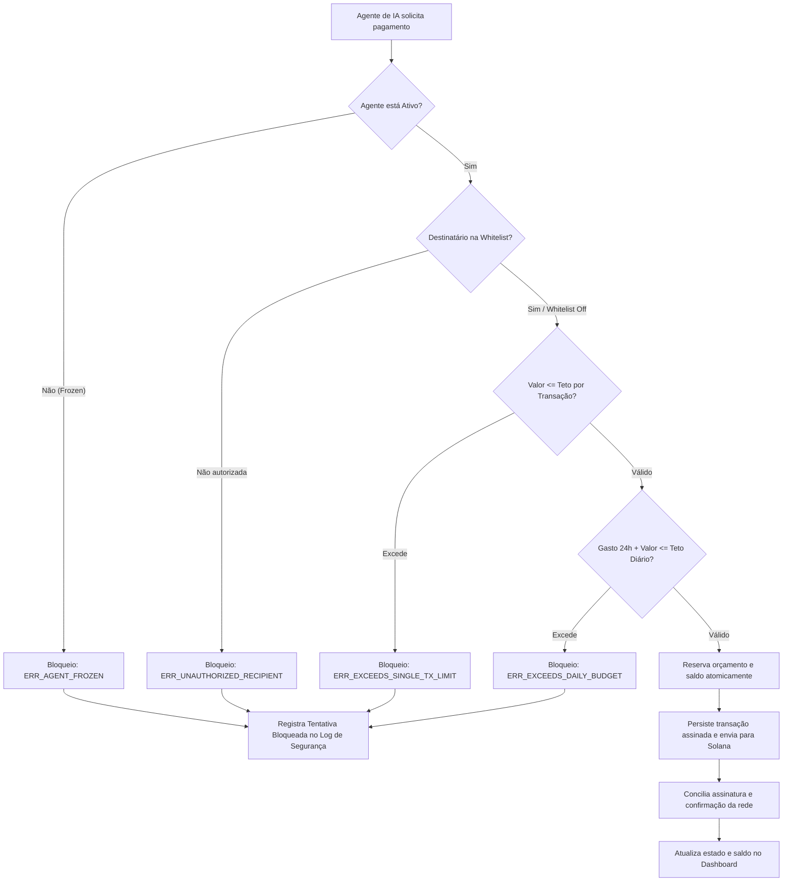
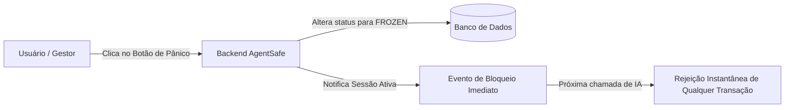

# PRD: AgentSafe — Autonomous AI Agent Budget & Security Vault

**Versão:** 1.2 (Integridade de pagamentos e modelagem revisadas)
**Data:** 08 de Outubro de 2026
**Status:** Escopo aprovado; correções de modelagem solicitadas pelo usuário em 2026-10-08
**Hackathon:** Crypto World’s Fair (Colosseum) — Track Solana / Agentic Payments
**Autor:** @pm (O Estrategista) & @analyst (O Cartógrafo)

---

## 1. Visão Executiva & Contexto

### 1.1 O Problema Real de Mercado
Em 2026, a economia de Agentes de IA Autônomos (AI Agent Economy) é a fronteira mais quente da tecnologia. Agentes pesquisam, codam, compram dados e interagem entre si na web. Para atingir plena autonomia, **agentes precisam de capacidade de pagamento e liquidação financeira**.

Entretanto, as ferramentas financeiras atuais apresentam falhas críticas:
1. **Risco de Liquidez & Drenagem (Prompt Injection / Bugs):** Se um humano compartilhar a chave privada de sua carteira principal com um agente de IA, qualquer falha de raciocínio, alucinação ou ataque adversário (ex: prompt injection forçando o agente a transferir fundos para um terceiro) drenará 100% do saldo do usuário em segundos.
2. **Incompatibilidade do Sistema Bancário Tradicional:** Cartões corporativos tradicionais (Visa/Mastercard) e contas bancárias exigem KYC humano, possuem latência de dias para liquidação internacional e cobram taxas inviáveis para microtransações de centavos entre robôs.

### 1.2 A Solução: *AgentSafe* ("O Brex dos Agentes de IA na Solana")
O **AgentSafe** é um protocolo e dashboard de **Cofres Inteligentes com Políticas de Gastos Programáveis** construído na rede de altíssima velocidade da Solana.
Ele permite que humanos financiem um cofre mestre e deleguem orçamentos controlados para sub-contas de agentes de IA com **regras invioláveis de segurança**:
* **Teto Diário (Daily Cap):** Limite máximo em janela móvel de 24 horas em UTC, incluindo valores reservados para pagamentos em andamento.
* **Teto por Transação (Single Tx Cap):** Limite máximo permitido em uma única compra.
* **Whitelist de Prestadores:** Restrição para transferir fundos apenas para prestadores de serviços pré-autorizados (ex: APIs de dados, oráculos, nós de GPU).
* **Kill Switch Instantâneo (Botão de Pânico):** Congelamento em sub-segundos de um agente ou de todos os robôs da organização com 1 clique.
* **Audit Trail Onchain:** Pagamentos confirmados possuem assinatura verificável na Solana; bloqueios e alterações administrativas são registrados localmente. O prazo de confirmação depende da rede.

---

## 2. Alinhamento Estratégico com o Crypto World’s Fair (Colosseum)

| Vetor de Avaliação | Como o AgentSafe se posiciona |
| :--- | :--- |
| **Venture Scale ($250k Pre-seed Colosseum)** | Infraestrutura essencial (B2B SaaS + Protocolo) para qualquer empresa ou desenvolvedor que utilize agentes de IA no mundo. |
| **Workshop Oficial da Solana Foundation** | Resposta direta e prática à trilha *"Solana Agentic Payments"* apresentada por Ludo (Solana Foundation). |
| **Vantagens Técnicas da Solana** | Tempo de bloco de ~400ms e taxas de $0.00025 tornam viáveis microtransações contínuas de $0.05 a $5.00 entre agentes. |
| **Pitch & Demo de 3 Minutos** | Visualmente impactante: demonstração de uma IA realizando pagamentos válidos e sendo travada em tempo real ao tentar burlar o limite. |

---

## 3. Personas & Casos de Uso

### Persona 1: Matheus, Engenheiro de IA / Desenvolvedor Autônomo
* **Cenário:** Matheus criou um agente que pesquisa dados de mercado e compra relatórios pagos via API.
* **Dor:** Não quer deixar sua carteira principal conectada ao script da IA, com medo de um loop infinito gastar centenas de dólares.
* **Solução com AgentSafe:** Ele cria o agente no dashboard, define um teto de $10/dia e máximo de $2/compra. O script da IA roda tranquilo sem risco de estourar a verba.

### Persona 2: Camila, Head de Produto em uma Startup de IA
* **Cenário:** O time da Camila gerencia uma frota de 15 agentes de IA operando tarefas de atendimento, automação e geração de conteúdo.
* **Dor:** Precisa de governança centralizada, auditoria de gastos por robô e um botão de emergência caso algum agente seja comprometido.
* **Solução com AgentSafe:** Dashboard unificado mostrando consumo em tempo real por robô, logs de segurança e botão de pânico geral para suspender qualquer agente com comportamento anômalo.

---

## 4. Requisitos do MVP

### 4.1 Requisitos Funcionais (RF)

| ID | Nome do Requisito | Descrição Detalhada |
| :--- | :--- | :--- |
| **RF01** | **Gestão de Cofre Mestre** | O usuário conecta sua carteira (Phantom) e visualiza/deposita saldo no cofre principal (ambiente Solana Devnet). |
| **RF02** | **Cadastro & Gestão de Agentes** | Criação de perfis de agentes com nome, propósito, chave pública e parâmetros de segurança: `daily_cap` e `single_tx_cap`. |
| **RF03** | **Políticas de Whitelist** | Configuração opcional de lista de carteiras/contratos permitidos para recebimento de fundos de cada agente. |
| **RF04** | **Motor de Validação de Limites** | Interceptação de cada requisição de pagamento da IA, validando limites de transação, limites diários e status do agente. |
| **RF05** | **Execução Onchain na Solana** | Transações que cumprem os requisitos de segurança são executadas e geram hash público no explorador da Solana. |
| **RF06** | **Bloqueio e Alerta de Segurança** | Tentativas que violam regras são bloqueadas com código de erro explícito e registradas no extrato de auditoria. |
| **RF07** | **Kill Switch (Botão de Pânico)** | Capacidade de congelar (`FROZEN`) um agente individual ou todos os agentes da conta imediatamente. |
| **RF08** | **Extrato de Telemetria Auditável** | Tabela em tempo real com histórico de transações aprovadas e rejeitadas, valores, fornecedores e links onchain. |
| **RF09** | **Simulador Interativo para Pitch** | Painel visual no frontend com gatilhos rápidos para simular na hora: (1) Pagamento Legítimo da IA; (2) Tentativa de Abuso/Excesso. |

### 4.2 Requisitos Não-Funcionais (RNF)

* **RNF01 - Latência de Decisão:** O motor de validação de políticas deve avaliar a requisição em menos de 100ms.
* **RNF02 - Integridade Financeira:** Novos envios exigem agente e cofre ativos, orçamento disponível e saldo suficiente para valor, taxas e reservas em andamento. Repetir uma solicitação não pode produzir um segundo pagamento.
* **RNF03 - Ambiente de Simulação Sem Custo:** Operação 100% em **Solana Devnet** com airdrop de moedas de teste, garantindo custo zero de desenvolvimento.
* **RNF04 - Separação Estrita de Camadas:** A lógica de negócio e regras de limite residem no backend/dados; o frontend consome via APIs padronizadas.

---

## 5. Regras de Negócio (RN)

```
[RN01] STATUS DO AGENTE
       Se agente ou cofre não estiver ACTIVE, bloquear novo envio com ERR_AGENT_FROZEN ou ERR_VAULT_FROZEN. Pagamentos já enviados não são cancelados pelo congelamento.

[RN02] TETO POR TRANSAÇÃO
       Representar valores em lamports inteiros positivos. Se amount_lamports > single_tx_cap_lamports, REJEITAR com código ERR_EXCEEDS_SINGLE_TX_LIMIT.

[RN03] TETO DIÁRIO (JANELA DE 24H)
       Somar confirmados cuja reserva começou nas últimas 24h e todas as reservas ainda em andamento, mesmo mais antigas. Validar e reservar atomicamente; se soma + amount_lamports > daily_cap_lamports, rejeitar com ERR_EXCEEDS_DAILY_BUDGET.

[RN04] POLÍTICA DE WHITELIST
       Se whitelist_ativa == true E destinatario NÃO ESTÁ na lista_permitida, REJEITAR com código ERR_UNAUTHORIZED_RECIPIENT.

[RN05] ATUALIZAÇÃO DO COFRE
       APPROVED significa autorização da política, não liquidação. Reservar valor e taxa antes do envio; CONFIRMED exige confirmação da rede. Falha comprovada libera reserva de valor; contabilizar taxas cobradas. Resultado UNKNOWN mantém reserva até conciliação.
```

---

### 5.1 Garantias adicionais do MVP

- Autenticar o proprietário antes de administrar ou consultar cofres. Autenticar o agente por credencial revogável e restringi-lo ao próprio perfil; `agentId` e endereços públicos não são autenticação.
- Usar chave de idempotência por agente. Repetição com o mesmo conteúdo retorna o pagamento existente; conteúdo diferente com a mesma chave é rejeitado.
- Persistir assinatura e referência à transação assinada antes do envio. Após reinício ou timeout, consultar e recuperar esse mesmo pagamento antes de decidir sobre novo envio.
- Registrar autor e antes/depois das mudanças de limites, whitelist, credenciais e congelamento em `audit_events`, sem segredos.
- Guardar apenas referência ao armazenamento protegido da chave privada no banco. A telemetria nunca expõe chaves, hashes de credenciais ou artefatos assinados.
- Para o MVP, a carteira identifica o proprietário; gestão de organizações e múltiplos usuários permanece fora do escopo.

## 6. Fluxos de Usuário & Sistema (Mermaid)

### 6.1 Fluxo de Execução de Pagamento do Agente de IA



### 6.2 Fluxo do Kill Switch (Botão de Pânico)



---

## 7. Critérios de Aceite para Entrega do MVP (Checklist da Banca)

- [x] Documento PRD detalhado e aprovado.
- [ ] Criação de cofre mestre vinculado a endereço de teste.
- [ ] Criação de pelo menos 2 agentes com políticas de teto distintas.
- [ ] Teste de transação legítima aprovada com hash real na Solana Devnet.
- [ ] Teste de transação abusiva rejeitada com alerta visual no dashboard.
- [ ] Botão de Pânico funcional congelando transações em tempo real.
- [ ] Repetição após timeout e reinício sem pagamento duplicado.
- [ ] Requisições simultâneas respeitam orçamento e saldo compartilhado.
- [ ] Autorização por proprietário/agente e auditoria das mudanças administrativas.
- [ ] Vídeo demonstrativo de 3 minutos validado para a submissão.
